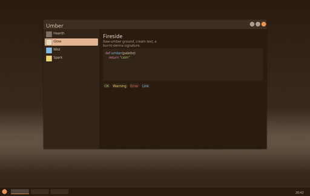
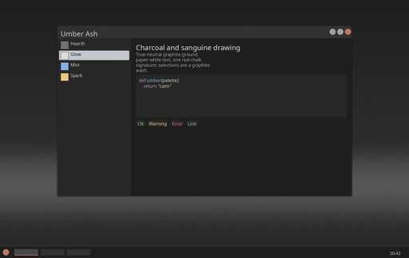
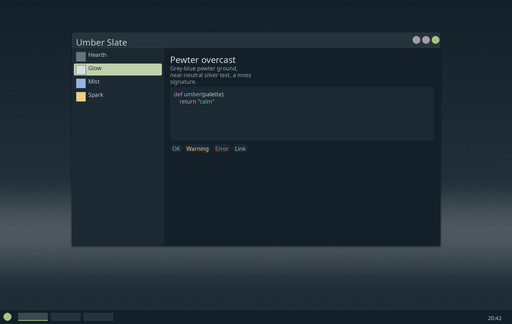
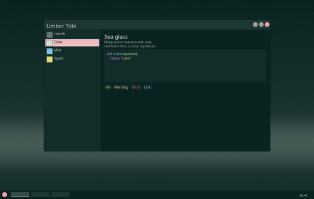
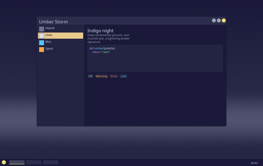
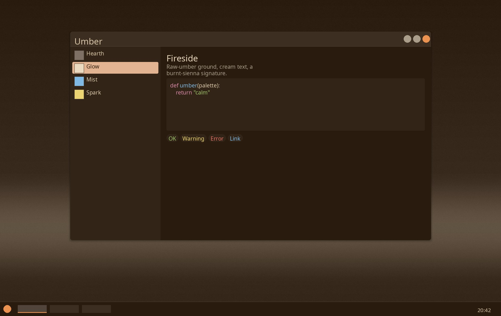

# Umber

[](LICENSE)
[](https://kde.org/plasma-desktop/)
[](https://addons.mozilla.org/en-US/firefox/addon/umber/)
[](https://github.com/viscous-values/umber/commits/main)

A quiet, earthy dark theme suite for KDE Plasma 6 and friends, built for long sessions. Five variants share one lightness ladder and one role map, and each has its own character: **Umber** (fireside: raw umber, cream, burnt sienna), **Ash** (charcoal and sanguine), **Slate** (pewter overcast, moss), **Tide** (sea glass, coral) and **Storm** (indigo night, lightning). Originally adapted from [MarianArlt/sddm-sugar-dark](https://github.com/MarianArlt/sddm-sugar-dark).

| Umber | Ash | Slate | Tide | Storm |
|:---:|:---:|:---:|:---:|:---:|
|  |  |  |  |  |



## Palette

Each variant's file ([`palette.toml`](palette.toml) for Umber, [`palettes/`](palettes) for the others) defines pigments in tiers; [`roles.toml`](roles.toml) says what each pigment is *for* (`link`, `focus_ring`, `selection_bg`, `syntax.type`, `ansi.black`, …), and every consumer template names roles, never raw pigments. Canonical Umber:

| Tier | Purpose | Colors |
|------|---------|--------|
| **Hearth** | surfaces, deepest → raised, then hover and control outline | `#291B0E` `#322417` `#3C2E21` `#51443A` · hover `#64574B` · outline `#7E7064` |
| **Glow**   | text, muted → strongest | `#AA9E8B` `#D9C6A8` `#EBDABF` `#F7EDDD` |
| **Mist**   | types, regex/info, functions/links, comments | `#8CCAAF` `#5DAEAE` `#80BAE4` `#958676` |
| **Spark**  | syntax and status hues | red `#E66F64` · orange `#F2A660` · amber `#EDD473` · green `#9FC56B` · violet `#D988A8` |
| **Accent** | the signature, its selection tint, and the colors drawn on the selection | signature `#EB9251` · selection `#E3B492` |

All five variants share the lightness ladder (surfaces OKLab L .235 / .272 / .312 / .398, text .705 / .835 / .895 / .950), so they feel like one family; hue, chroma and the signature carry each variant's identity. Every palette passes [`scripts/palette_audit.py`](scripts/palette_audit.py): WCAG AA text contrast on every surface it's drawn on, 3:1 focus rings and input outlines, separation between roles that must read differently, color-blindness simulation, and cross-variant identity. [`PALETTE-REVISIT.md`](PALETTE-REVISIT.md) has the before/after numbers for the 2026-10 redesign; the earlier palettes live in [`palettes/archive/classic/`](palettes/archive/classic).

To see the whole family side by side (Plasma, VSCode and Konsole mockups, grayscale and color-blindness views, and an OKLCH tuner), run `python3 scripts/render_lab.py` and open `mockups/palette-lab.html`.

## Variants

Each variant is a painter's limited palette: a ground, a text temperature, one signature accent (focus rings, active tabs, primary buttons, progress) with a light selection tint drawn from it, and its own syntax key.

| Variant | Concept | Ground | Text | Signature | Selection |
|---|---|---|---|---|---|
| **Umber** (canonical) | fireside | raw umber `#291B0E` | cream `#D9C6A8` | burnt sienna `#EB9251` | `#E3B492` |
| **Ash** | charcoal and sanguine drawing | neutral graphite `#1E1E1E` | paper white `#CAC9C4` | red chalk `#BD7564` | graphite wash `#C3C8CE` |
| **Slate** | pewter overcast | pewter `#132029` | silver `#C6CACB` | moss `#A4C485` | `#C0D2AC` |
| **Tide** | sea glass | deep teal `#092321` | sea-foam `#C5CCBB` | coral `#FA9BAC` | `#ECBCC2` |
| **Storm** | indigo night | ultramarine `#1A1939` | moonlit `#BFC9E0` | lightning `#EBDE77` | gold `#E8CA8D` |

Each variant ships a complete theme suite (LookAndFeel package, Plasma Shell lockscreen, Konsole, VSCode, Firefox, Chromium, SDDM). Mockups live in [`mockups/`](mockups) (`<variant>-{filemanager,textsample,ui-catalog,swatches}.png`), and the Palette Lab compares them all.

Install any variant alongside canonical:

```fish
./install.sh --variant ash      # charcoal and sanguine
./install.sh --variant slate    # pewter overcast, moss
./install.sh --variant tide     # sea glass, coral
./install.sh --variant storm    # indigo night, lightning
./install.sh --all-variants     # canonical + all four variants in one run
```

`--all-variants` does one sudo prompt and one live Plasma apply at the end — canonical Umber goes active by default, or pass `--variant N` alongside to make N active instead. Variants and canonical coexist on the same machine.

To switch between installed variants, either pick one from KRunner / the app launcher (search "Apply Umber") or run the script directly:

```fish
./scripts/apply-variant.sh ash    # umber | ash | slate | tide | storm
```

`install.sh` writes a per-variant `umber-apply-<v>.desktop` launcher to `~/.local/share/applications/` so each variant shows up in KRunner, the app menu, and Plasma's search as **Apply Umber Ash Theme**, etc.

**Why not the System Settings tile picker?** Plasma 6's `plasma-apply-lookandfeel` (the binary the Global Theme KCM calls when you click Apply) is broken for any third-party LookAndFeel package: it updates the `LookAndFeelPackage` key but silently no-ops the color-scheme transition, so `[Colors:*]` in `kdeglobals` stays on the previous variant's values and apps don't repaint. `apply-variant.sh` (and the launchers above) work around it by running `plasma-apply-colorscheme BreezeLight` followed by the real scheme — the throwaway BreezeLight step defeats the "already set" short-circuit so the next apply actually writes `[Colors:*]` back into `kdeglobals` for the live session.

## Components

| Path | What it is | Where it deploys |
|------|------------|------------------|
| `io.github.viscous-values.umber/` | Plasma 6 Look-and-Feel package + `Umber.colors` color scheme | `~/.local/share/plasma/look-and-feel/io.github.viscous-values.umber/` and `~/.local/share/color-schemes/Umber.colors` |
| `umber-shell/` | Plasma 6 Shell package — overrides only `contents/lockscreen/` to match the SDDM layout (charcoal floor + 0.55 scrim); falls back to `org.kde.plasma.desktop` for everything else | `~/.local/share/plasma/shells/io.github.viscous-values.umber-shell/`, activated via `kscreenlockerrc [Greeter]/Theme=io.github.viscous-values.umber-shell` |
| `konsole/Umber.colorscheme` | Konsole 16-ANSI palette | `~/.local/share/konsole/Umber.colorscheme` (referenced by a Konsole profile) |
| `umber-sddm/` | SDDM greeter theme — Qt6 port of sddm-sugar-dark with solid charcoal background | `/usr/share/sddm/themes/umber/` (system-wide; needs sudo) |
| `umber-vscode/` | VSCode / code-oss color theme extension | `~/.vscode-oss/extensions/viscous-values.umber-2.0.0` (or `~/.vscode/extensions/` for Microsoft VSCode) |
| `umber-firefox/` | Firefox WebExtension theme (manifest v2) | loaded via `about:debugging` (temporary) or signed for permanent install |
| `umber-chromium/` | Chromium / Chrome theme extension (manifest v3) | loaded unpacked via `chrome://extensions/` |
| `preview.svg` | Small thumbnail for store listings, rendered from the palette | — |

Bundled assets:
- **Cursor:** `cursors/Umber-cursor/` — pre-built recolor of [Nordic-cursors](https://github.com/EliverLara/Nordic-cursors) (Nord palette → Umber palette, pixel-by-pixel). Regeneratable via `scripts/build-cursor.sh` if you have Nordic-cursors at `~/.icons/Nordic-cursors`.
- **Wallpaper:** `io.github.viscous-values.umber/contents/wallpapers/Umber/` — 4K palette-tinted gradient. Regeneratable via `scripts/render_wallpaper.py`.
- The cursor recolor reads canonical `palette.toml` at build time; the committed cursor still carries the pre-redesign canonical colors until it is rebuilt with `scripts/build-cursor.sh`.

External dependency (auto-installed by `install.sh`):
- **Icons:** [Newaita-reborn-light-brown-dark](https://github.com/cbrnix/Newaita-reborn) — desaturated taupe folders match Umber's `glow.dim` register. The Global Theme references it by name; `install.sh` clones and copies the `Newaita-reborn-light-brown-dark/` variant if it isn't already present at `~/.local/share/icons/`.

## Install

### Platform requirements

`install.sh` is **Linux + KDE Plasma 6 only**. SDDM is required for the login-screen theme; the LookAndFeel package, Plasma Shell lockscreen, and Konsole scheme all rely on Plasma 6 binaries (`plasma-apply-lookandfeel`, `plasma-apply-colorscheme`, `kwriteconfig6`, `kbuildsycoca6`). The script doesn't call distro package managers — it assumes those binaries are already present on a working Plasma 6 desktop.

The browser themes (Firefox, Chromium) and the VSCode extension are **cross-platform** and don't need `install.sh`. Install them independently from AMO / the Chrome Web Store / VSCode Marketplace if you're not on KDE.

Tools `install.sh` invokes: `git`, `python3`, `plasma-apply-lookandfeel`, `plasma-apply-colorscheme`, `kwriteconfig6`, `kreadconfig6`, `kbuildsycoca6`, plus `sudo` for the SDDM block.

### Run

```fish
./install.sh                     # canonical warm Umber
./install.sh --variant ash       # any single variant; see Variants section above
./install.sh --all-variants      # canonical + all four variants in one run
./install.sh --migrate           # one-time: clean up legacy "Hush" / com.tyler.* installs
./install.sh --no-sudo           # skip the SDDM sudo prompt; print manual steps
```

User-space steps (Newaita icons, Umber cursor, color scheme, LookAndFeel package, lockscreen Shell package, Konsole scheme, VSCode extension link) run unprivileged, then the Global Theme is applied. Root-needing steps (SDDM theme install, `/etc/sddm.conf.d/` shadow-file cleanup, `Current=` rewrite) are gathered into a single sudo prompt that fires AFTER the user-space installs but BEFORE the live Plasma reload: the script prints the exact commands, asks once, runs them while the sudo cache is held, then releases it (`sudo -k`). Decline at the prompt — or pass `--no-sudo` — to print the manual steps instead. Browser themes (Firefox / Chromium) always need browser UI and stay in the manual-steps tail.

The `--variant` flag is fully orthogonal — each variant installs into its own per-variant directories (`io.github.viscous-values.umber-ash/`, `umber-ash-shell/`, `umber-ash-sddm/`, etc.) so canonical and any number of variants can coexist on a single machine.

### What the Global Theme covers

| Component | Auto-applied by Global Theme | Notes |
|-----------|:---:|---|
| Color scheme (Umber) | yes | via `defaults` |
| Window decoration colors | yes | reads `[WM]` from the colorscheme |
| Cursor (Umber-cursor) | yes | needs cursor installed first; `install.sh` handles |
| Icons (Newaita-reborn-light-brown-dark) | yes | needs icons installed first; `install.sh` handles |
| Splash screen | yes | the `Splash.qml` in this LnF |
| Lockscreen UI | yes | shipped via the `umber-shell` Plasma/Shell package; `install.sh` flips `kscreenlockerrc [Greeter]/Theme` |
| Wallpaper | yes | bundled in `contents/wallpapers/Umber/` |
| Plasma widget style | no (uses Breeze) | no custom Plasma Style ships in v1 |
| Aurorae window decoration | no (uses Breeze) | colorscheme drives titlebar palette |
| Konsole profile colors | no | apply via Konsole settings (scheme is installed) |
| SDDM theme | no | system-wide; needs sudo (see footer) |
| VSCode color theme | no | needs editor restart + theme pick |
| Firefox / Chromium themes | no | browser-side load |

## Install (per component)

If you want to install only one piece, the originals:

### Plasma colorscheme + Look-and-Feel
```fish
cp -r io.github.viscous-values.umber ~/.local/share/plasma/look-and-feel/io.github.viscous-values.umber
# IMPORTANT: strip contents/colors/ from the installed package. If a LnF
# package ships a colors/ dir, plasma-apply-lookandfeel (which is what
# System Settings → Global Theme → Apply runs) wipes [Colors:*] out of
# kdeglobals and never repopulates — apps fall back to white Breeze Light.
rm -rf ~/.local/share/plasma/look-and-feel/io.github.viscous-values.umber/contents/colors
cp io.github.viscous-values.umber/contents/colors/Umber.colors ~/.local/share/color-schemes/Umber.colors
kbuildsycoca6 --noincremental
cd /tmp; plasma-apply-lookandfeel -a io.github.viscous-values.umber
# Force-reapply the colorscheme (toggle through BreezeLight to make Plasma rewrite [WM] inline values)
plasma-apply-colorscheme BreezeLight
plasma-apply-colorscheme Umber
```

### Lockscreen (Plasma 6 shell package)
```fish
cp -r umber-shell ~/.local/share/plasma/shells/io.github.viscous-values.umber-shell
kwriteconfig6 --file kscreenlockerrc --group Greeter --key Theme io.github.viscous-values.umber-shell
# Test it: loginctl lock-session   (Ctrl+Alt+L on most setups)
```

### Konsole
```fish
cp konsole/Umber.colorscheme ~/.local/share/konsole/Umber.colorscheme
# In Konsole: Settings → Edit Current Profile → Appearance → choose Umber
```

### SDDM (system-wide login)
```fish
# Test first (windowed):
sddm-greeter-qt6 --test-mode --theme $PWD/umber-sddm
# Install + activate:
sudo cp -r umber-sddm /usr/share/sddm/themes/umber
sudo sed -i 's/^Current=.*/Current=umber/' /etc/sddm.conf.d/kde_settings.conf
```

### VSCode / code-oss
```fish
ln -sfn $PWD/umber-vscode ~/.vscode/extensions/viscous-values.umber-2.0.0
# (or ~/.vscode-oss/extensions/ for code-oss)
# Microsoft VSCode caches its extension list and won't pick up a symlink until
# extensions.json lists it. This adds (or updates) that entry; then fully quit
# and relaunch the editor:
python3 scripts/register_vscode_extension.py --extensions-dir ~/.vscode/extensions --version 2.0.0
# Then Ctrl+K Ctrl+T → Umber.
```

### Firefox
Each variant is a self-contained WebExtension theme — `manifest.json` plus a `icons/` directory rendered from `palette.toml`. Variants have distinct gecko ids (`umber@viscous-values`, `umber-tide@viscous-values`, …) so they install side-by-side from AMO.

**Install from AMO (one-click, signed, persistent):**

- [Umber](https://addons.mozilla.org/en-US/firefox/addon/umber/) — canonical warm
- [Umber Ash](https://addons.mozilla.org/en-US/firefox/addon/umber-ash/) — neutral charcoal
- [Umber Slate](https://addons.mozilla.org/en-US/firefox/addon/umber-slate/) — overcast
- [Umber Tide](https://addons.mozilla.org/en-US/firefox/addon/umber-tide/) — teal dusk
- [Umber Storm](https://addons.mozilla.org/en-US/firefox/addon/umber-storm/) — slate-blue night sea

Build signed-ready `.xpi` archives locally (e.g. when adding a variant before AMO submission):
```fish
./scripts/build-firefox-xpi.sh           # all five variants → dist/*.xpi
./scripts/build-firefox-xpi.sh tide      # one variant
```

**Dev install (unsigned, doesn't survive restart in stable Firefox):**
```fish
# Visit about:debugging#/runtime/this-firefox
# "Load Temporary Add-on…" → pick <variant>-firefox/manifest.json
```

> **Don't add a profile-level `userChrome.css` overlay.** Earlier Hush-era builds shipped one with `!important` rules; it overrode every WebExtension theme so all variants looked identical. The current architecture relies entirely on what the manifest's `theme.colors` block exposes — whatever Firefox's WebExtension theme API can't reach (URL bar dropdown rows, sidebar internals) falls back to stock dark, which is the AMO-shipped reality.

### Chromium / Chrome
```fish
# Persistent, no signing required — browser allows unpacked themes.
#   1. Visit chrome://extensions/
#   2. Toggle "Developer mode" (top right)
#   3. "Load unpacked" → pick the umber-chromium/ folder
```

## Known gotchas

- **`plasma-apply-colorscheme Umber` says "already set" and is a no-op** when the scheme is already current — Plasma keeps any stale inline `[WM]` values in `~/.config/kdeglobals`. Toggle through another scheme (e.g. `BreezeLight`) first to force the rewrite.
- **Don't run `plasma-apply-lookandfeel -a io.github.viscous-values.umber` from the project directory.** `kpackagetool6` resolves the source dir as a package path and the apply fails. Run from `/tmp` or anywhere outside the repo.
- **Existing Konsole tabs hold the old palette** — open a new tab to see scheme changes.
- The look-and-feel package's `metadata.json` needs `KPlugin.ServiceTypes: ["Plasma/LookAndFeel"]` *plus* top-level `X-Plasma-MainScript` and `X-Plasma-APIVersion`, otherwise `plasma-apply-lookandfeel` lists it but cannot apply it.

## Origin & credits

- **Sugar Dark** by [Marian Arlt](https://github.com/MarianArlt/sddm-sugar-dark) (2018) — base for the SDDM theme and the warm-on-dark direction. Umber muted the palette (`#FFDEAD` navajowhite → `#D4BC91`; pure white `#FFFFFF` → `#E1E1E1`; View bg lifted `#1F1F1F` → `#242424`) and ported the QML to Qt6/Plasma 6. Upstream QML in `umber-sddm/` retains its GPL headers, and `umber-sddm/AUTHORS` + `CREDITS` + `COPYING` are preserved verbatim.
- **Atom One Dark** and **Nord** ([arcticicestudio/nord](https://www.nordtheme.com/)): the Spark and Mist accents through v1.0.1 came from One Dark and leaned on Nord's `nord8/9/10`. The 2026-10 redesign replaced them with per-variant pigments; the earlier values are kept in `palettes/archive/classic/`.
- **Nordic-cursors** by [EliverLara](https://github.com/EliverLara/Nordic-cursors) — pixel-source for `cursors/Umber-cursor/`. The recolor in `scripts/recolor_nordic_inplace.py` walks every xcursor binary and remaps Nord palette → Umber palette while preserving anti-aliased edges.
- **Newaita-reborn** by [cbrnix](https://github.com/cbrnix/Newaita-reborn) — paired icon set (`Newaita-reborn-light-brown-dark` variant); auto-installed by `install.sh`. Not redistributed in this repo.

Licensed GPL-3.0-or-later. See `LICENSE` at the repo root.
